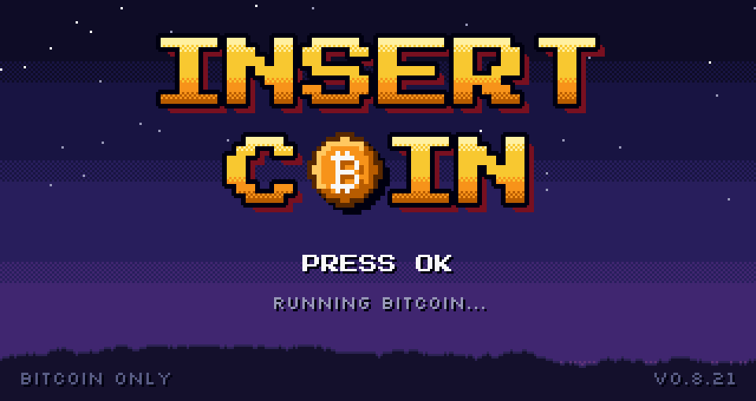
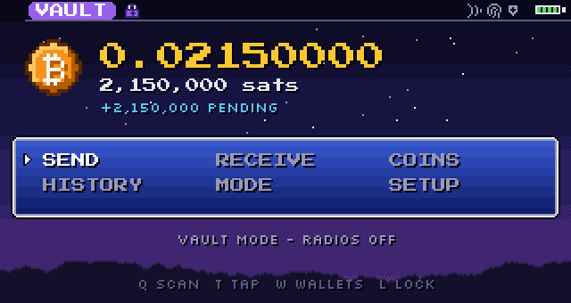
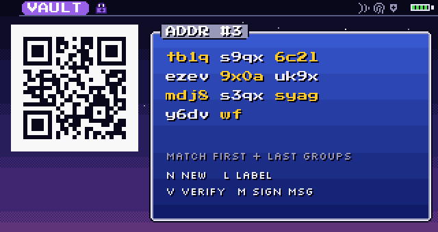
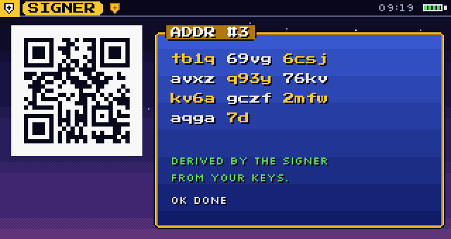
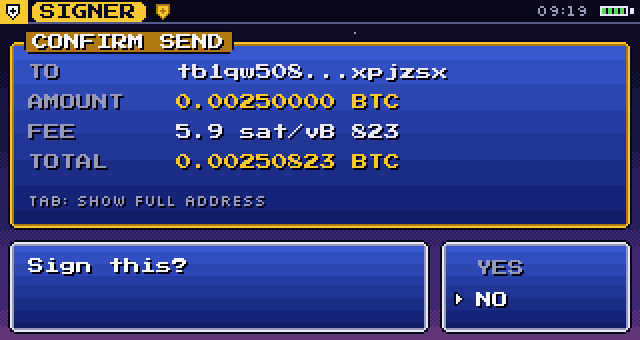
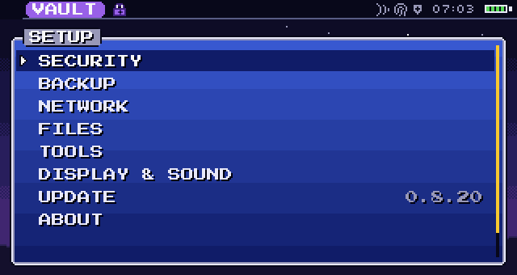
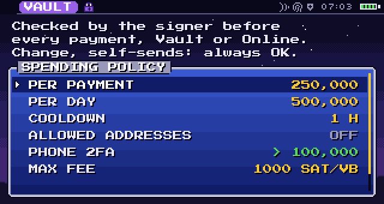
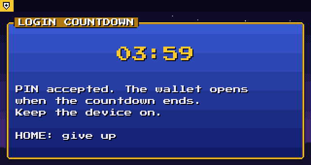
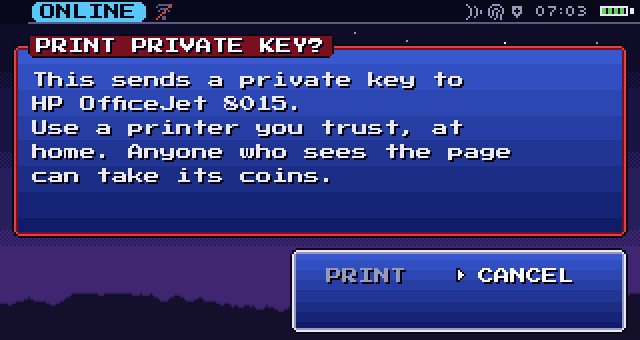

<p align="center">
  
</p>

<h1 align="center">Insert Coin</h1>

<p align="center">
  <b>A Bitcoin wallet for the M5Stack Cardputer Zero, with a 16-bit arcade look.</b><br>
  Starts with every radio off. Only the signer, in its own locked-down process, ever touches your keys.
</p>

<p align="center">
  <a href="docs/Insert-Coin-Instruction-Booklet.pdf">Instruction booklet (PDF)</a> ·
  <a href="SECURITY.md">Security model</a> ·
  <a href="docs/AUDIT.md">Security review</a> ·
  <a href="CHANGELOG.md">Changelog</a> ·
  <a href="LICENSE">License</a> ·
  <a href="docs/HARDWARE_TEST.md">Hardware test plan</a>
</p>

> [!WARNING]
> Insert Coin is new and **has not had an outside security audit**. The same
> person who wrote it reviewed it. Use testnet or signet first, and keep only
> small amounts on it until it has been reviewed independently.

---

It boots to an animated INSERT COIN title screen (the bitcoin is the O, and
"Running bitcoin..." is a nod to Hal Finney's first tweet about Bitcoin), and
OK plays an original chiptune fanfare. Then it's a full wallet: send, receive,
coin control, multisig, inheritance, tap cards, paper wallets, all on the
Cardputer's own screen and keys.

| | | | |
|:-:|:-:|:-:|:-:|
|  |  |  |  |
| **Home** | **Receive** | **Verify on the signer** | **Confirm send** |
|  |  |  |  |
| **Setup** | **Spending policy** | **Login countdown** | **Print a paper wallet** |

## Features

**Two modes.** Vault mode (the boot default) has Wi-Fi, Bluetooth and
Ethernet switched off: sign PSBTs by animated QR or microSD with Sparrow or
any watch-only wallet. Online mode talks to your own Electrum server, through
Tor by default, and sends straight from the device, limited by a daily
online cap.

**Wallet**
- BIP39 seeds (12 or 24 words). New seeds mix the kernel RNG, the secure chip
  if fitted, and any dice rolls, coin flips, card shuffles or key mashing you add
- Native SegWit (BIP84) and Taproot (BIP86), several accounts per seed, optional passphrase
- Coin control, labels, fee bumps and cancels (RBF), CSV history export
- Multisig cosigner (BIP48, descriptors) and inheritance wallets with a time-locked heir key
- Child seeds (BIP85), message signing (BIP137, BIP322)
- QR in every format that matters: PSBT, UR, BBQr, SeedQR
- SATSCARD and TAPSIGNER over NFC

**Backups**: seed words, SeedQR, SLIP39 split shares, and an encrypted card
backup of accounts, multisig wallets, labels and settings (no seed inside).

**Guards**, all on the signer and all changed only with your PIN:
- **Spending policy**: per payment, per day, cooldown, address allow-list, max fee rate
- **Phone 2FA** (TOTP) for every payment or only big ones
- **Bypass PIN** that locks the policy, so your PIN alone can't loosen it or export the seed
- **Login countdown**: a wait of 5 minutes to 24 hours after the right PIN
- **Wipe PIN** (erases everything, device starts like new) and **duress PIN** (opens a decoy wallet)
- **Auto lock** after 2 to 15 minutes, a custom time, or never
- Ten wrong PINs erase the wallet; every kind of PIN costs the same time to check

**Extras**: paper wallets kept off the microSD card, printed at home over
encrypted IPP with a pinned printer certificate, or downloaded with SHARE
FILES (password-protected, local network only, switches itself off). Optional
secure chip and fingerprint sensor. One sound switch for the menu boop and
the title fanfare.

## How it's put together

Separate processes, each its own Linux user, so a bug in one doesn't hand
over the others:

| Process | Holds | Network |
|---|---|---|
| **czsigner** | the seed, while unlocked; the screen and keyboard | none |
| **czapp** (the wallet you see) | public keys, history, labels | none |
| **cznet** | nothing | Tor and your Electrum server only |
| **czscan** | nothing; sees the camera | none |
| **czshare** | history exports and paper wallets, while sharing | local network only |
| **czprint** | paper wallets, while printing | local printers only |

The signer doesn't trust the app. It draws its own screens (gold shield in
the corner, your two security words on PIN screens), asks for your PIN and
your YES itself, re-reads every PSBT, re-derives every input and change
output from the seed, needs full previous transactions for SegWit v0 inputs,
checks your spending rules, and signs only the exact PSBT you confirmed.
[SECURITY.md](SECURITY.md) goes through what each process is trusted with
and what's known to be weak.

## Try it on your PC (simulator)

```
pip install -r requirements.txt pygame
python3 sim.py
```

The real app in a window at 3x size. It runs on **signet** (mainnet is off,
because a seed typed into a PC is hot) and simulates Vault/Online without
touching your network settings. Keys follow the Cardputer layout: Enter = OK,
Backspace = DEL, Esc = HOME, F Z X C or the arrow keys move. F12 saves a
screenshot. Data lives in `./simdata`; delete it to start over.

On Windows, put paths with spaces in quotes: `cd "C:\Users\you\Insert Coin"`.

## Install on the Cardputer Zero

Insert Coin comes in two editions. **Pick by how much money it will hold.**

| | **Savings edition** | **Spending edition** |
|---|---|---|
| What it is | A wallet image: the device boots into Insert Coin and runs nothing else | An app in M5Stack's launcher, next to your other apps |
| For | Savings, real amounts | Spending money only, like cash in a pocket |
| Other apps on the device | None | Anything you install from M5Stack's store, which could reach the wallet while it's open |
| How it's labelled | **SAVINGS WALLET** on the title screen, *Savings* in the file name | **SPENDING WALLET** on the title screen, *Insert Coin Spending* in the launcher |

The wallet inside is the same: the signer in its own locked-down process,
Vault mode at every start, your PIN and spending rules. The difference is
what else shares the device. [SECURITY.md](SECURITY.md#app-mode) has the
details.

### Savings edition

**Wallet image (recommended).** Burn
`Insert-Coin-Savings-<version>-cardputerzero.img.xz` from the releases page
with M5 Imager or Raspberry Pi Imager (*Use custom*), after checking its
SHA-256. It's M5Stack's CardputerZero OS with Insert Coin installed in
dedicated mode by `tools/build_image.sh`, built in public by the *Build
wallet image* workflow, so anyone can see what went in. It fits an 8 GB card
or bigger. It takes **no logins at all**: SSH is off and every account's
password is locked, so the screen and keyboard are the only way in. Browsers,
media players and remote-desktop servers are removed from it.

**Or on the card you already have:** `sudo sh deploy/install.sh --dedicated`,
then `sudo reboot`. `sudo sh deploy/uninstall.sh` brings the launcher back.

### Spending edition

Keeps the CardputerZero home screen; **Insert Coin Spending** gets an icon
there. Over SSH:
```
sudo apt-get install -y git
git clone https://github.com/Revolution81/Insert-Coin.git
cd Insert-Coin && sudo sh deploy/install.sh --app
```
Opening the icon starts the wallet in Vault mode; SETUP › EXIT TO MENU locks
it, stops every wallet service and puts Wi-Fi back as it was.
To update: `cd ~/Insert-Coin && git pull && sudo sh deploy/install.sh --app`
(quick after the first time: steps already done are skipped).
`sudo sh deploy/uninstall.sh` removes it. Keep only spending money on it.

The installer creates the service users, installs the code under
`/opt/czwallet-releases/<version>` with a Python venv, the data folders, the
root helpers (radios on/off, signed updates, backups), a polkit rule for
Wi-Fi, and Tor. Dependencies are pinned with SHA-256 hashes in
`requirements.lock`.

Things to check on a device (keys, screen, network, camera) are in
[docs/HARDWARE_TEST.md](docs/HARDWARE_TEST.md). Try **signet** first: choose
NETWORK on the welcome screen.

## Keys

Menus: **F Z X C** move (the arrows printed on F▲ Z◀ X▼ C▶), **OK** select,
**DEL** back, the **HOME** button home.
Home screen: **S** send, **R** receive, **H** history, **M** mode, **Q** scan
anything, **T** tap a card, **W** wallets, **L** lock.
Receive: **N** new address, **L** label, **V** verify on the signer, **M** sign a message.
Typing: every key types, **fn + F Z X C** moves the cursor, **OK** done, **HOME** cancel.

## Develop

```
pip install -r requirements.txt pytest
python3 -m pytest tests                     # 425 tests, offline
python3 tools/fuzz.py                       # junk input at every parser
python3 tools/monkey.py 10 1500             # random key-mashing robot
python3 tools/leakcheck.py                  # long-running memory loops
python3 tools/shots.py shots/               # screenshots of the real app
```

<details>
<summary>Source layout</summary>

```
app.py                 the app: menus, camera, watch-only wallet
sim.py                 desktop simulator (pygame)
core/
  signer.py            the only code with private keys; checks every PSBT
  signer_service.py    runs the signer as its own user; owns screen and keyboard
  trusted.py           what the app may ask the signer (no PIN or seed ever crosses)
  vault.py             seed encrypted at rest: Argon2id + AES-GCM, PIN tries, wipe
  policy.py            spending policy, TOTP 2FA, bypass PIN
  seed.py              BIP39 seeds and entropy mixing; BIP84 keys
  accounts.py          wpkh:N (BIP84) and tr:N (BIP86) accounts
  wallet.py            watch-only wallet: coins, history, build PSBT, broadcast
  electrum.py, netd.py Electrum client (TLS, Tor) and the cznet relay
  scand.py             czscan: camera + QR decoding, sandboxed
  qr.py, ur.py         what a QR means; UR codes
  multisig.py, inherit.py, split.py, bip85.py, message.py, backup.py
  cktap.py, hw/        SATSCARD/TAPSIGNER, NFC, secure chip, fingerprint
  paper.py, printing.py, ipp.py, mdns.py   paper wallets and printing
  share.py             SHARE FILES web server
  update.py            reproducible release builds, signatures, safe install
ui/                    screens, theme, title, sound, and the signer's own screens
deploy/                systemd units, root helpers, install.sh
tools/                 tests on hardware, releases, fuzzer, monkey, screenshots
tests/                 python3 -m pytest tests
```
</details>

## Security notes, honestly

- **No outside audit yet.** Read [SECURITY.md](SECURITY.md) and
  [docs/AUDIT.md](docs/AUDIT.md) for the threat model, the internal review
  and the known gaps.
- Without the optional secure chip, someone who copies the microSD card can
  try PINs offline against the vault file, slowed only by Argon2 (64 MiB,
  about 1 to 2 s per guess on the CM0). A 6-digit PIN would fall in days that
  way. Use a longer PIN or a passphrase you don't store, or fit the chip.
- Online mode makes it a hot wallet. The online cap and your spending rules
  limit the damage.
- SD cards remap blocks, so wiping can't promise every old copy is gone.
  Treat a lost card as exposed to the offline attack above.
- Keep real savings on the savings edition, in Vault mode, or in a multisig
  where this device is one key. The spending edition is for spending money.

## License

**Source-available, not open source.** Anyone may read, audit, build and run
Insert Coin, including paid security reviews, under the
[PolyForm Strict License 1.0.0](LICENSE) plus the extra permissions at the top
of that file. Publishing or distributing it, changed or not, needs written
permission. Third-party libraries and fonts keep their own licenses: see
[THIRD_PARTY_NOTICES.md](THIRD_PARTY_NOTICES.md).

Found a security problem? Please report it privately: see
[SECURITY.md](SECURITY.md#reporting).

Insert Coin is an independent project, not affiliated with or endorsed by
M5Stack. Cardputer Zero is a product of M5Stack. Bitcoin only.
