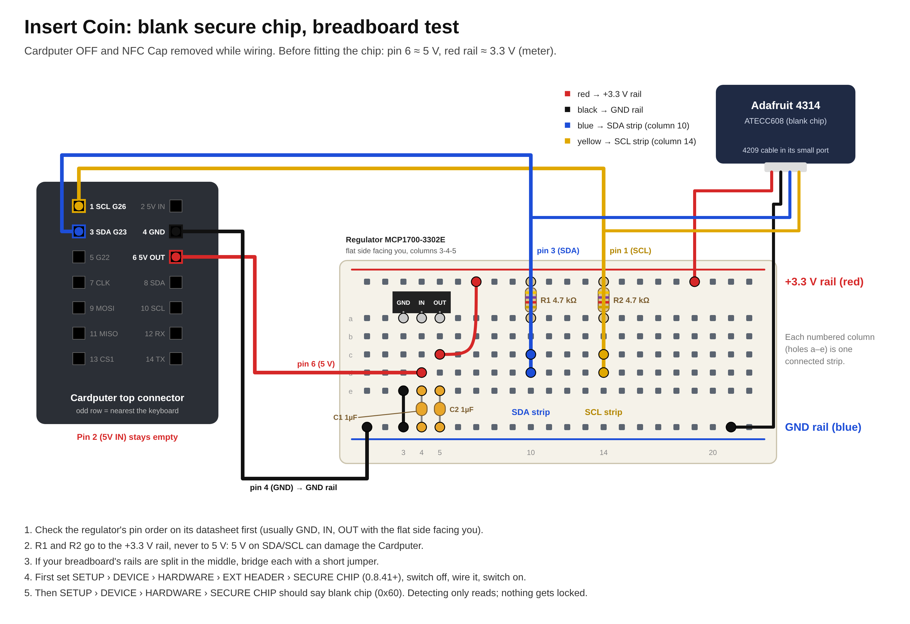
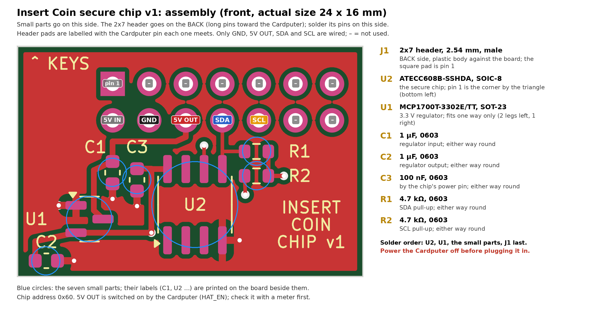

# Secure chip board (v1, untested)

A 24 x 16 mm board that plugs onto the Cardputer Zero's **EXT 2x7 header**
and gives Insert Coin a **blank ATECC608B** secure chip, for the mode where
the chip itself counts wrong PINs.

**Status: designed, not yet built.** Prove the same circuit on a breadboard
first (Adafruit 4314 breakout + MCP1700 + two 1 µF capacitors + two 4.7 kΩ
pull-ups to 3.3 V + male-to-male jumper wires), then order.

## Breadboard test first

`breadboard-test.svg` / `.png`, made by `gen_breadboard.py`.

## Circuit

- EXT pin 6 (**5V OUT**) -> MCP1700T-3302E/TT -> **3.3 V** for the chip.
  1 µF in, 1 µF out, 100 nF at the chip.
- EXT pin 3 (**G23 SDA**) and pin 1 (**G26 SCL**) to the chip, with 4.7 kΩ
  pull-ups to 3.3 V. That's a **bus of its own** (I2C bus 3, software I2C
  on GPIO23/26), set up from SETUP › DEVICE › HARDWARE › EXT HEADER ›
  SECURE CHIP (0.8.41+), then a restart.
- EXT pin 4 GND. **Pin 2 (5V IN) is not connected**: it powers the device.
- The chip answers at **0x60**, alone on its bus.

**Why not pins 8 and 10 (I2C1), as v1 first had it:** that bus carries the
keyboard (0x34), battery gauge (0x55), audio codec (0x10), the IO expander
(0x4F) and the RTC. The chip's power on pin 6 only comes on once the wallet
starts, and until then the unpowered chip and its pull-ups held those wires
down: the keyboard and the IO expander never started, and the IO expander
restarted the Cardputer in a loop (M5 logo, black, M5 logo...). Seen on the
device, 2026-11-26. On its own bus an unpowered or miswired chip can't stop
anything from starting. **The board drawing below still routes SDA/SCL to
pins 8 and 10 and needs the same change before it's ordered.**

From M5Stack's schematic (V0.6.1): 5V OUT goes through a load switch
enabled by the IO expander's **HAT_EN** line. M5Stack's system keeps it off
(the "LED" `ext_5v_out`, default off); Insert Coin 0.8.31 and later switch
it on at start and on RESCAN (confirmed on the device with the NFC Cap).
Check with a meter on the breadboard first anyway.

The NFC Cap uses the same EXT header, so it's one or the other: take the
Cap off (device powered off) for this board.

## Building it

- Parts on the **front** (outside). The **2x7 male header goes on the back**,
  plastic body against the board, long pins pointing at the Cardputer,
  soldered on the front.
- Seen from the front, the pin rows match the label on the Cardputer: odd
  pins (G26 ... G7) on the row nearest the keyboard (`^ KEYS`), even pins
  (5V IN, GND, 5V OUT, SDA, SCL, ...) below.
- **Power the Cardputer off before plugging it in or out.** The port isn't
  hot-swappable.
- Check the fit against the microSD slot to the right of the header before
  ordering. The board extends 1.3 mm past the header's right-hand pins.

## Files

| File | What |
|---|---|
| `secure-chip.kicad_sch`, `.kicad_pcb`, `.kicad_pro` | KiCad 7 project |
| `secure-chip-schematic.pdf` | the schematic |
| `secure-chip-assembly.png` | where each part goes, which way round, and what each header pin is |
| `fab/secure-chip-gerbers.zip` | upload to JLCPCB / PCBWay (2 layers, 1.6 mm) |
| `fab/secure-chip-bom.csv`, `fab/secure-chip-cpl.csv` | parts list and placement, for assembly |
| `gen_sch.py`, `gen_pcb.py`, `make_fab.sh` | the design is generated by these; `make_fab.sh` rebuilds and re-checks everything |
| `check_net.py`, `check_pcb.py`, `drc.rpt` | netlist and copper checked against the intended connections; KiCad DRC: 0 violations |

Part of Insert Coin; same license as the rest of the repository.
